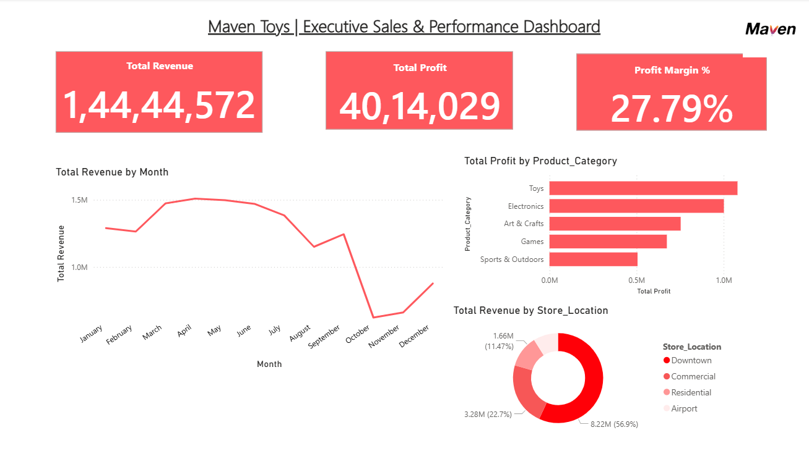

# 📊 Maven Toys Retail Analytics & Executive BI Dashboard

An end-to-end retail business intelligence project analyzing **820,000+ transaction records** from Maven Toys (a Mexican retail chain). This project demonstrates relational database modeling, enterprise SQL analytics using window functions, and an interactive executive Power BI dashboard built with custom DAX calculations.

---

## 🚀 Live Dashboard Preview



---

## 🛠️ Tech Stack & Architecture

- **Database Management:** MySQL Server 8.0 & MySQL Workbench
- **Business Intelligence & Reporting:** Microsoft Power BI Desktop
- **Data Modeling:** Star Schema (1 Fact Table, 3 Dimension Tables, 1 Dynamic Date Table)
- **Analytical Methods:** DAX (`SUMX`, `RELATED`, `DIVIDE`), Window Functions (`DENSE_RANK()`, `LAG()`), Common Table Expressions (CTEs), Multi-Table Joins & Aggregations

---

## 📈 High-Level Executive KPIs

| Metric | Value | Description |
|---|---|---|
| **Total Revenue** | **$14.44M** | Gross sales across all 50 stores and product lines |
| **Total Cost** | **$10.43M** | Cumulative Cost of Goods Sold (COGS) |
| **Total Net Profit** | **$4.01M** | Total net earnings realized |
| **Profit Margin %** | **27.79%** | Overall operational sales efficiency |

---

## 💡 Key Business Insights

1. **Category Dominance:**
   - **Toys** ($1.08M profit) and **Electronics** ($1.00M profit) generate the highest absolute profitability, contributing over **52%** of enterprise net earnings.
   - **Sports & Outdoors** yields the lowest profit margin ($0.51M), indicating higher acquisition and inventory holding costs.

2. **Geographic Footprint:**
   - **Downtown locations** drive the bulk of retail volume, accounting for **56.9% ($8.22M)** of gross enterprise sales.
   - **Airport stores** contribute the lowest share (11.47%), representing an untapped optimization or footprint consolidation opportunity.

3. **Seasonality:**
   - Sales demonstrate strong cyclical demand from March through July, with historical volume tapering off toward late Q3.

---

## 🔍 SQL Analytical Queries

The full analysis script is accessible in [`maven_toys_analysis.sql`](maven_toys_analysis.sql). Below are core highlights:

### 1. Product Category Ranking (`DENSE_RANK()`)
Evaluates volume against total margin contribution to prioritize inventory allocation:
```sql
SELECT 
    p.Product_Category,
    SUM(s.Units) AS Units_Sold,
    ROUND(SUM(s.Units * p.Product_Price), 2) AS Revenue,
    ROUND(SUM(s.Units * (p.Product_Price - p.Product_Cost)), 2) AS Total_Profit,
    DENSE_RANK() OVER (ORDER BY SUM(s.Units * (p.Product_Price - p.Product_Cost)) DESC) AS Profit_Rank
FROM sales s
JOIN products p ON s.Product_ID = p.Product_ID
GROUP BY p.Product_Category;
